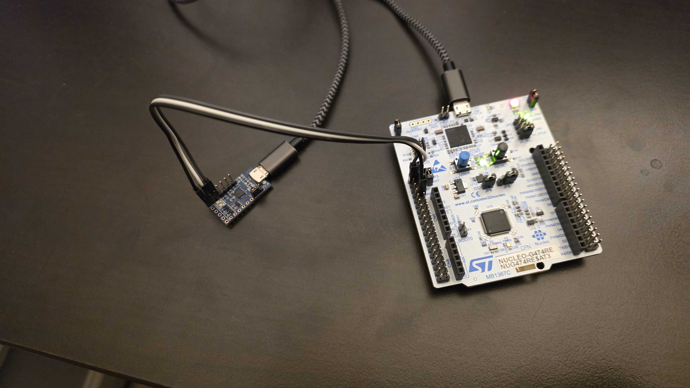

# uartloopback
## Overview
A simple STM32 application that accepts data on the UART Rx line and immediately loops it back onto the UART Tx line

<video src="./doc/uartloopback.mp4" controls autoplay loop> 
    Your browser does not support the video tag.
</video>

## Hardware
- ST Nucleo 64 board with STM32G474RE MCU
- FTDI LC231x UART-to-USB bridge

## Software
- STM32CubeG4 - assumed to be at the 
- monkeyHAL - STM32 HAL wrapper

## Pinout
| Sensor        | STM32F3 bus | STM32F3 GPIO         | Nucleo Pin |
| ------------- | ----------- | -------------------- | ---------- |
| FTDI LC231x   |  UART3 Rx   |  PC10 (Tx)           | CN7 pin 1  |
| FTDI LC231x   |  UART3 Tx   |  PC11 (Rx)           | CN7 pin 2  |

## Build
- Install appropriate ARM compiler
- Build with `make`
- Flash with STM32Programmer (or equivalent)
